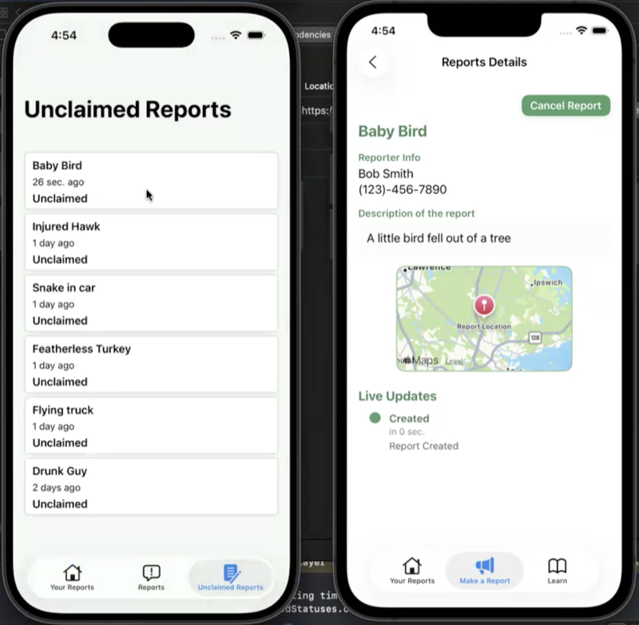
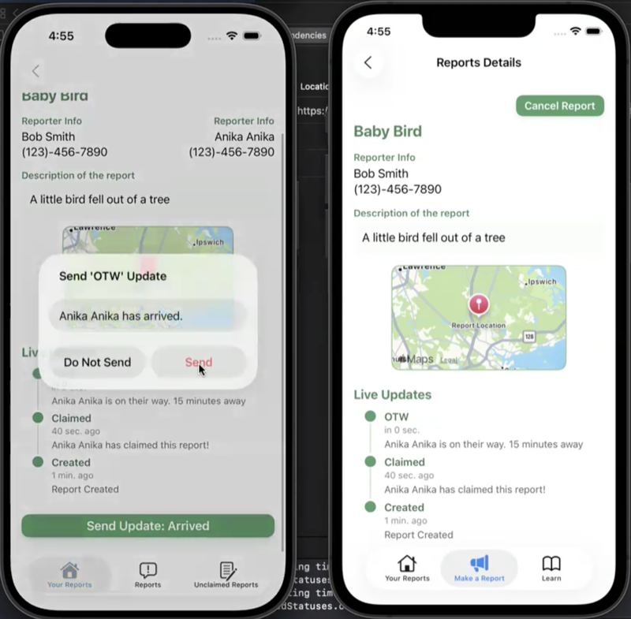
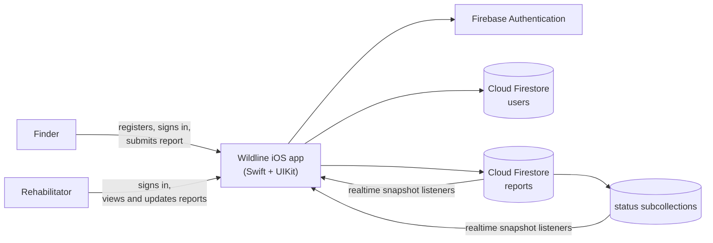

# Wildline

**An iOS application that streamlines the wildlife rescue process for rehabilitators.**

Developed over 7 weeks by Max, Erika, Ciara, and Anika for CS 4520: Mobile Application Development.

[Demo video](https://drive.google.com/file/d/1XBe3z0jOBfxZl8Eh83UnqifEWQGnsZHk/view?usp=sharing)

---

## How it works

Wildline support two roles, rehabilitators and finders (the general public), each with their own views once they log in.

**Finders**: Finders can log in and report where they have found an animal that needs help.

**Rehabilitators**: A rehabilitator can find that report in map view or list view and respond to it.

<figcaption>Left: Rehabilitator list view, Right: Finder report view</figcaption>

### Tracking the rescue

The rehabilitatos can then track their progress in the app. This transparency keeps the finder involved, which encourages them to continue reporting when they find wildlife that needs saving.

<figcaption>Left: Rehabilitator sending updated, Right: Finder seeing updates</figcaption>

---

## Tech stack

| Layer | Technology |
| --- | --- |
| Language | Swift |
| UI | UIKit |
| Authentication | Firebase Authentication |
| Database | Cloud Firestore |
| Realtime updates | Firestore snapshot listeners |

Firebase stores the users and reports, and provides authentication. The application is coded in Swift, using UIKit. The realtime updates are through a Firebase listener pattern.

---

## App architecture

The app uses Firebase Authentication for account access and Cloud Firestore for users, reports, and rescue-status updates. Snapshot listeners keep report and progress views current for both participants.

---

## Anika's contribution
<small>AI generated, Checked by me</small>

I owned the **report lifecycle** — everything that happens to a report after a finder submits it — plus the shared UI layer the rest of the team built screens on top of.

### Features

**Status timeline and lifecycle state machine.** I designed the `Status` model and the engine that drives a report from `Created → Claimed → OTW → Arrived → Finished`. Rather than hardcoding transitions, `setNextAction()` reads the most recent status from Firestore and walks a declared `updateOrder` array to derive the next valid step, so the rehabilitator's action button relabels itself ("Send Update: Arrived") without any screen knowing the sequence. Adding a stage to the workflow means editing one array.

**Claim and withdraw.** Claiming a report is a three-part write — stamp the rehabilitator onto the report document, append a `Claimed` status, and add a `ReportRef` to that rehabilitator's own `reports` subcollection. `withdrawReport()` unwinds all three and posts a `Withdrawn` status so the finder sees why their report went back in the queue. Keeping those denormalized writes consistent in both directions was the trickiest part of the project.

**Report Details**, the screen both roles share but see differently — it reconfigures itself through `configureForRehabber` / `configureForReporter` / `configureForUnclaimed` / `configureForViewer` rather than branching inline, and hides the action button once a report reaches a terminal state. I also built **Quick Look** (the rehabilitator's preview-and-claim sheet), the **Make Report** screen, and the **Reports Map** built on MapKit.

**Auth polish.** I wired the login screen to Firebase Authentication and added the validation layer on registration — email regex, empty-field errors, and the conditional rule that rehabilitators must supply a name and phone number.

**A shared design system.** `ViewStyling.swift` is a `UIView` extension exposing `createStyledTextField`, `createStyledPrimaryButton`, `createStyledSecondaryButton`, and matching label and text-view factories. Once it landed, the whole team's screens picked up a consistent green visual language for free.

### Patterns and skills

| Pattern | Where |
| --- | --- |
| MVC with a strict View/ViewController split | custom `UIView` subclasses assigned in `loadView()`, fully programmatic Auto Layout |
| Separating persistence from view logic | Firestore I/O lives in `*FBViewController` extensions, keeping view controllers focused on presentation |
| Swift concurrency | `async`/`await` over Firestore, `Task` for bridging into UIKit, `MainActor.run` to hop back for UI updates |
| Realtime sync | Firestore snapshot listeners so a rehabilitator's update appears on the finder's timeline without a refresh |
| Type-safe persistence | `Codable` models with `@DocumentID`, read and written via `data(as:)` and `addDocument(from:)` |
| Protocol-oriented design + child VC containment | `ProgressSpinnerDelegate` with a reusable spinner added as a child view controller |
| Data-driven state | the `updateOrder` array as a single source of truth for the workflow |

---

## Repository history

This repo is a copy of a private repo that was created for this project. This repo preserves the commit history but removes API keys and other private information from the commits.

## AI disclosure

AI was used to debug specific problems or explain how to code specific features through the duration of this project, but was not used to generate code at large.
